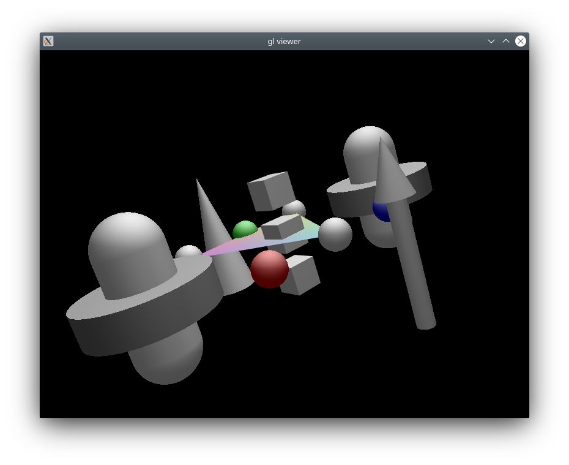
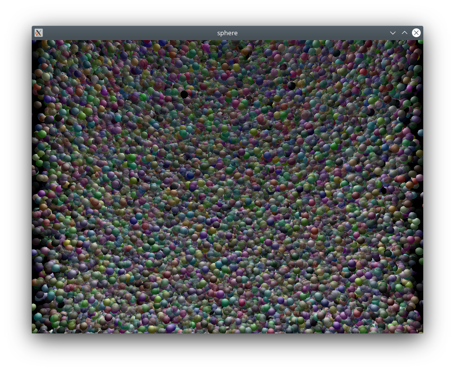
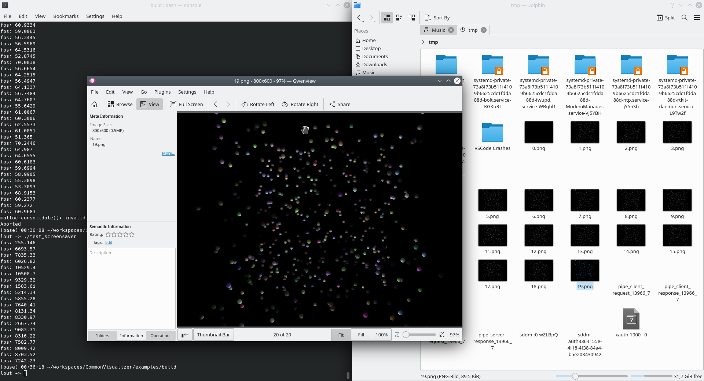

# CommonVisualizer

CommonVisualizer is a C++/OpenGL library for interactive 3D visualization of simulation and computation data. It supports meshes, point clouds, spheres, cylinders, capsules, cones, arrows, boxes, lines, and coordinate signs.

The library is primarily header-based: include `CommonVisualizer.hpp` in your application.

## Features

- Colored and unicolor meshes
- Static and updateable point clouds
- 3D primitives and coordinate signs
- Mouse and keyboard camera controls
- Multiple named scenes
- PNG color and depth screenshots
- C++ application examples

## Requirements

- C++14-compatible compiler
- CMake 3.6 or newer
- FreeGLUT
- GLEW
- GLFW 3
- GLM
- OpenGL and GLU
- libpng++
- Eigen 3 (required by the full example set)

For a Debian/Ubuntu-based development environment, the dependencies can be installed with:

```bash
sudo apt-get install build-essential cmake pkg-config \
  libx11-dev libgl1-mesa-dev libglu1-mesa-dev libglm-dev \
  libglew-dev libglfw3-dev libpng++-dev freeglut3-dev libeigen3-dev
```

## Build the Examples

```bash
cmake -S examples -B build
cmake --build build -j
```

Run an example from the repository root:

```bash
./build/test_spheres
```

The examples include:

| Executable | Description |
| --- | --- |
| `test_all` | Meshes, point clouds, and primitive objects |
| `test_spheres` | Animated colored sphere point cloud |
| `test_screensaver` | Capture frames as PNG images |
| `test_depth_map_saver` | Capture depth maps as PNG images |
| `test_sep` | Visualization of separable systems |

An X11 display is required to open the OpenGL windows.

## Quick Start

```cpp
#include "CommonVisualizer.hpp"

int main() {
  loco::CommonVisualizer visualizer(
      600, 800, "mesh viewer", loco::color::BLACK);

  if (!visualizer.isInited()) {
    return 1;
  }

  visualizer.setDistance(5.0f);
  visualizer.setLightSource(loco::Vec{{0.0f, 0.0f, 10.0f}},
                            loco::color::WHITE);

  const std::vector<float> vertices{
      -0.5f, -0.5f, 0.0f,
       0.5f, -0.5f, 0.0f,
       0.0f,  0.5f, 0.0f,
  };
  visualizer.addMesh(vertices, loco::color::GREEN);

  while (visualizer.playOnce()) {
  }
}
```

Compile an application from the repository root:

```bash
g++ -std=c++14 my_app.cpp -I. \
  -lGL -lGLEW -lGLU -lglut -lglfw -o my_app
```

## Camera Controls

| Input | Action |
| --- | --- |
| `W` / `S` | Rotate vertically |
| `A` / `D` | Rotate horizontally |
| `N` / `F` | Zoom out / zoom in |
| Arrow keys | Translate the camera |
| Left mouse drag | Rotate |
| Middle mouse drag | Zoom |
| Right mouse drag | Translate |

## Common API

```cpp
visualizer.setActiveWorld("objects");
visualizer.resetScene();
visualizer.resetScene("objects");

visualizer.addMesh(vertices, loco::color::RED);
visualizer.addBox(transform, scale, loco::color::BLUE);
visualizer.addLine(positions, radius, loco::color::WHITE);

const std::uint32_t cloud_id =
    visualizer.addPointCloud(points, colors, radius);
visualizer.updatePointCloud(cloud_id, updated_points);

visualizer.setTransform(transform);
visualizer.setTransformCamera(camera_transform);
```

Scenes can be divided with `setActiveWorld()`. Use `resetScene()` to clear the active scene or the entire visualizer.

See [examples/test_all.cpp](examples/test_all.cpp) and [examples/test_spheres.cpp](examples/test_spheres.cpp) for complete examples.

## Screenshots

### Supported primitives



### Animated spheres



### PNG screenshot generation


